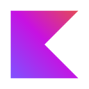
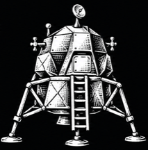

<strong>Applied AI &amp; Mobile Engineer</strong> <samp>Jakarta, Indonesia</samp>

<a href="https://portfolio-website-finn-christoffer.vercel.app/">Portfolio</a> &nbsp;·&nbsp; <a href="https://www.linkedin.com/in/finnchristoffer/">LinkedIn</a>

<h2 align="center">What should your app be able to do tomorrow?</h2>

I’m Finn Christoffer Kurniawan. I help clients turn an idea into a working AI feature, connect it to a mobile app, or automate a task their team keeps doing by hand. If you have a rough brief, we can start with one useful feature you can try.

I build language-model features in my own products. My professional work focuses on banking and commerce apps. On DBank Pro, I worked on biometric sign-in and on keeping features usable when a connection drops. I work in English and Bahasa Indonesia.

<h2 align="center">Tech stack</h2>

| Area | What I work with |
| --- | --- |
| Applied AI | LLM-powered app features,  Supabase integrations |
| AI-assisted engineering |  Claude Code,  Codex, spec-driven workflows, project instructions in `AGENTS.md` |
| Languages |  Python,  Swift,  Dart,  JavaScript |
| Backend & integration |  Supabase, REST APIs, WebSocket,  Firebase |
| Mobile | SwiftUI, UIKit,  Flutter, SwiftData, Core Data,  Android,  Kotlin Multiplatform (KMP) / Kotlin Multiplatform Mobile (KMM) |
| Testing & delivery | XCTest,  GitHub Actions,  Jenkins, Fastlane, TestFlight |
| Monitoring & analytics |  Firebase Crashlytics, PostHog |

I’m an AI enthusiast currently researching how developers can use coding agents in existing projects. I’m exploring how the context I give an agent shapes the code it writes. My workflow starts with a short spec and project notes for Claude Code or Codex, followed by code review and testing.

<h2 align="center">Selected projects</h2>

**[RAWG.IO](https://github.com/finnchristoffer/RAWG.IO)** · SwiftUI, SwiftData, Tuist

A game discovery app with searchable titles and locally saved favorites. I used it to explore how to split an app into modules. The repo includes a dependency graph, tests, and the GitHub Actions workflow that checks each change.

**[One SwiftUI feature, three architectures](https://github.com/finnchristoffer/MV-vs-MVVM-vs-TCA)** · Swift Observation, MVVM, TCA

I built the same GitHub user explorer three times to answer one question. When does a SwiftUI feature need a view model? Each version handles debounced search, navigation, and saved favorites, so you can compare the implementations side by side.

**[V60 Manual Brew](https://github.com/finnchristoffer/WWDC22-V60-Manual-Brew)** · Apple Swift Student Challenge winner, 2022

A Swift playground that walks you through brewing pour-over coffee, from grinding the beans to choosing a hot or Japanese iced V60.

<h2 align="center">Engineering experience</h2>

- **Erafone** — I built the networking layer with URLSession and used dependency injection to let squads develop features independently.
- **UIKit and SwiftUI** — I used UIHostingController to introduce SwiftUI screens into existing UIKit apps so teams could migrate one feature at a time.
- **Team development** — I mentored five junior engineers on testing and code review, and automated cherry-picks into the team's integration branch.

<h2 align="center">Work with me</h2>

Tell me who the feature is for, what they do today, and where they get stuck.

<a href="https://www.linkedin.com/in/finnchristoffer/">Get in touch on LinkedIn</a>

